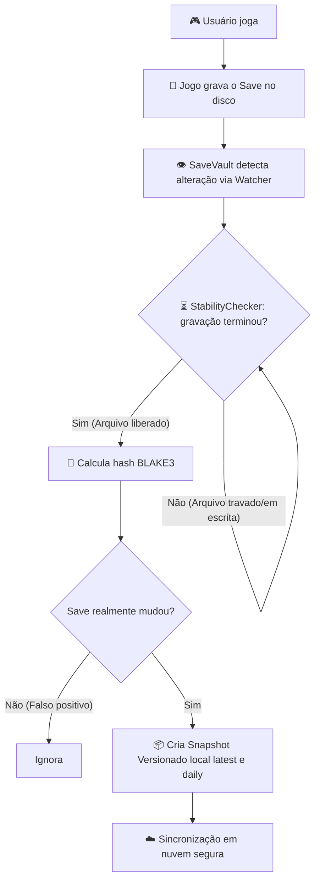

# SaveVault

> **Você joga. O SaveVault encontra, versiona e protege seus saves automaticamente.**

---

## 🎮 O que é o SaveVault?

O **SaveVault** é uma ferramenta moderna, leve e autônoma desenvolvida em **Rust** para **Windows (10 e 11 x64)**, criada com um propósito muito claro: **ser uma rede de segurança invisível e automática para os arquivos de save dos seus jogos**.

Quantas vezes um jogador já perdeu dezenas ou centenas de horas de progresso porque:
- O jogo crashou durante um salvamento automático (*autosave*) e **corrompeu o único arquivo de save**?
- O jogo **não tem suporte a nuvem** (jogos antigos, títulos independentes, versões DRM-free do GOG ou emuladores)?
- O computador precisou ser formatado e os saves estavam **espalhados em pastas ocultas e obscuras** do sistema (`%APPDATA%`, `%LOCALAPPDATA%`, `Saved Games`, `Documents` ou chaves de registro)?
- O serviço de nuvem tradicional sincronizou um arquivo corrompido por cima do progresso válido?

O SaveVault resolve esse problema de ponta a ponta. Ele opera em segundo plano com **consumo mínimo de CPU e memória**, descobre onde os seus jogos guardam seus saves, monitora modificações em tempo real enquanto você joga, cria **snapshots locais versionados** com garantia criptográfica (**BLAKE3**) e sincroniza tudo com a sua própria nuvem (**Google Drive**).

---

## 🚫 O que o SaveVault NÃO é

Para evitar qualquer confusão sobre o escopo do projeto:

- ❌ **Não é um launcher de jogos**: O SaveVault não gerencia inicialização de jogos, amigos ou loja (como Steam, Epic ou GOG Galaxy).
- ❌ **Não faz backup de jogos instalados**: Ele não armazena os 50GB–100GB de executáveis, texturas ou áudio de jogos instalados.
- ❌ **Não é gerenciador de mods**: Não sincroniza pastas de mods, shaders, screenshots ou vídeos gravados.
- ❌ **Não depende de servidores de terceiros**: O SaveVault se conecta diretamente entre o seu computador e a sua conta pessoal da nuvem (Google Drive), garantindo 100% de privacidade dos seus dados.

> **Foco Absoluto**: O SaveVault é especializado única e exclusivamente na **proteção, versionamento, integridade e restauração de dados de progresso (saves)**.

---

## 💡 Como Funciona (O Ciclo de Vida do SaveVault)



1. **Descoberta Inteligente**: Ao iniciar, o SaveVault rastreia seus discos para localizar jogos instalados e mapear exatamente onde os saves de cada um ficam gravados.
2. **Monitoramento por Eventos (Sem Polling)**: Em vez de ficar lendo o HD continuamente (o que causaria lentidão e consumo de disco), o SaveVault usa APIs nativas do Windows (`ReadDirectoryChangesW` via crate `notify`) para ser acordado apenas quando um arquivo for realmente tocado.
3. **Proteção Contra Saves Incompletos (*StabilityChecker*)**: Jogos costumam manter arquivos abertos e bloqueados durante a escrita. Se um backup tentar ler esse arquivo imediatamente, ele geraria um save corrompido ou cortado pela metade. O SaveVault detecta códigos nativos de travamento do Windows (`ERROR_SHARING_VIOLATION` 32 e 33) e aguarda o jogo fechar o arquivo antes de agir.
4. **Histórico Versionado**: Cada alteração gera versões no motor de 2 pastas (`latest` e `daily`). Se um save quebrar, você pode voltar no tempo para o estado de minutos atrás ou do primeiro save do dia.
5. **Restauração com Cinto de Segurança**: Antes de restaurar qualquer versão antiga por cima do save atual, o SaveVault gera automaticamente um arquivo de segurança (`.savevault_safety_bak`). Nada é sobrescrito sem volta.
6. **Sincronização em Nuvem Tolerante a Falhas**: Os snapshots são integrados ao Google Drive Desktop / nuvem pessoal de forma assíncrona e transparente.

---

## ⚡ Diferenciais do SaveVault

| Recurso | Steam Cloud | Ludusavi | GameSave Manager | **SaveVault** |
|:---|:---:|:---:|:---:|:---:|
| **Monitoramento em Background em Tempo Real** | ❌ (Apenas ao fechar o jogo) | ❌ (Manual ou por script) | ❌ (Manual/Agendado) | ✅ **Sim (Contínuo e Automático)** |
| **Jogos Fora da Steam (GOG, Emuladores, Indústria)** | ❌ Não | ✅ Sim | ✅ Sim | ✅ **Sim (Multi-plataforma)** |
| **Múltiplas Versões Históricas (Rollback)** | ❌ (Apenas última versão) | ✅ Sim | ✅ Sim | ✅ **Sim (Configurável)** |
| **Proteção Contra Escrita Incompleta (Lock Win32)** | ❌ | ❌ | ❌ | ✅ **Sim (StabilityChecker nativo)** |
| **Sincronização Direta com Nuvem Pessoal** | ❌ (Apenas nuvem Steam) | ⚠️ (Requer Rclone ou cloud tools) | ⚠️ (Upload manual via FTP/Dropbox antigo) | ✅ **Nativo (Google Drive)** |
| **Segurança de Credenciais** | Própria | N/A | Texto plano | ✅ **Windows Credential Manager** |
| **Consumo de Recursos** | Baixo | Médio | Alto | ✅ **Mínimo (~15MB RAM em Rust nativo)** |

---

## 🔍 Cobertura de Descoberta de Jogos

O SaveVault combina múltiplos motores de descoberta para garantir que nenhum jogo passe despercebido:

- **Steam**: Lê os arquivos de configuração multi-bibliotecas (`libraryfolders.vdf`) e realiza o parsing nativo dos manifestos `.acf`.
- **GOG Galaxy**: Varre diretamente as chaves do Registro do Windows (`HKLM\SOFTWARE\GOG.com\Games` em 32 e 64-bit), suportando identificadores numéricos (DWORD) e strings.
- **Emuladores Dedicados**: Suporte estruturado e perfis pré-configurados para **Dolphin** (GameCube/Wii), **PCSX2** (PS2), **PPSSPP** (PSP) e **RetroArch**.
- **Catálogo Oficial Ludusavi**: Integração com a base de conhecimento de mais de **53.000 jogos**, resolvendo dinamicamente variáveis do Windows (`<winAppData>`, `<winDocuments>`, `<storeUserId>`, etc.).
- **Heurística Genérica Inteligente (`generic.rs`)**: Detecta jogos independentes e avulsos em `%APPDATA%`, `%LOCALAPPDATA%`, `Saved Games` e `Documents`, utilizando algoritmos de pontuação e listas estritas de exclusão para **eliminar falsos-positivos** (pastas do sistema, navegadores, Discord, etc.).
- **Deduplicação Cruzada**: Se o motor genérico encontrar uma pasta que sobreponha o caminho oficial do jogo encontrado via Catálogo/Loja, a entrada genérica é ignorada para evitar registros duplicados.
- **Cadastro Manual**: Caso tenha algum jogo personalizado ou pasta específica, você pode registrá-lo com um único comando na CLI.

---

## 🏛️ Arquitetura do Sistema (Workspace Modular)

O projeto é composto por 8 *crates* desacoplados, seguindo rigorosos padrões de concorrência e integridade:

```
crates/
├── savevault-core/       # Modelos de dados universais, configuração e normalização Win32
├── savevault-db/         # Banco SQLite local (rusqlite bundled) com migrações 001 a 005
├── savevault-discovery/  # Detectores: Steam, GOG, Emuladores, Heurística e Ludusavi
├── savevault-monitor/    # Watcher assíncrono (notify), Debouncer e StabilityChecker Win32
├── savevault-backup/     # Assinaturas BLAKE3, gerenciamento de snapshots (latest/daily)
├── savevault-cloud/      # Integração Google Drive, OAuth 2.0 PKCE e Windows Credential Manager
├── savevault-sync/       # Fila transacional de sincronização com retentativas exponenciais
└── savevault-app/        # CLI, orquestrador do daemon de monitoramento contínuo e DEV-UI
```

---

## 💻 Requisitos do Sistema

- **Sistema Operacional**: Windows 10 ou Windows 11 (64-bit).
- **Rust Toolchain**: Rust 1.80+ (compatível com `stable-x86_64-pc-windows-gnu` / MinGW e `stable-x86_64-pc-windows-msvc`).
- **Google Drive Desktop** ou conta do Google Drive para sincronização em nuvem.

---

## 🛠️ Como Instalar e Compilar

```powershell
# 1. Clonar o repositório
git clone https://github.com/pedrojunior01/Savevalt.git
cd Savevalt

# 2. Configurar variáveis opcionais (Opcional - detecção automática da pasta de nuvem já é o padrão)
copy .env.example .env

# 3. Compilar em modo release
cargo build --release
```

O executável otimizado estará disponível em: `target/release/savevault.exe`.

---

## 📖 Como Usar a CLI

| Comando | Descrição |
|:---|:---|
| `savevault` | Inicia o **daemon residente**: varre os jogos instalados e entra no loop contínuo de monitoramento em tempo real com reconciliação periódica offline. |
| `savevault --once` | Executa a varredura e descoberta de jogos uma única vez, salva os locais no banco de dados e encerra imediatamente. |
| `savevault add <nome> <caminho>` | Cadastra manualmente um jogo e uma pasta de save específica para monitoramento. |
| `savevault list` | Lista todos os jogos e diretórios atualmente monitorados e registrados no banco SQLite. |
| `savevault restore list` | Exibe a lista de todos os snapshots históricos disponíveis para restauração. |
| `savevault restore <BACKUP_ID>` | Restaura um snapshot específico no disco com criação prévia de *safety backup*. |
| `savevault autostart [enable\|disable\|status]` | Gerencia a inicialização automática do SaveVault junto ao Windows (HKCU\Run). |
| `savevault --ui` | Inicia a **DEV-UI**: servidor HTTP local em `http://127.0.0.1:4040` para inspecionar jogos, status e fila no navegador. |
| `savevault --help` | Exibe as opções de ajuda da CLI. |
| `savevault --version` | Exibe a versão instalada do SaveVault. |

---

## 🚀 Tutorial Rápido de Uso

O SaveVault agora utiliza um motor de versionamento inteligente (**`latest`** e **`daily`**) voltado para sincronização nativa na nuvem (Google Drive Desktop, OneDrive ou Dropbox).

### Passo a Passo:

1. **Configuração da Nuvem (Google Drive Desktop):**
   - Instale o aplicativo oficial do **Google Drive Desktop** (ou OneDrive/Dropbox).
   - O SaveVault salva os arquivos de backup localmente na pasta definida em `config.toml` (por padrão: `%APPDATA%\SaveVault\backups` ou sua pasta do Drive sincronizada).

2. **Iniciando o Monitoramento:**
   - Abra um terminal e execute:
     ```powershell
     cargo run -p savevault-app
     # Ou simplesmente:
     savevault
     ```
   - O aplicativo fará uma varredura automática (via Catálogo Ludusavi e Heurística) para descobrir todos os seus jogos e, em seguida, entrará em modo **Watcher**.

3. **Iniciando o Dashboard (Interface Visual):**
   - Para monitorar os saves através de um painel web no navegador, execute:
     ```powershell
     savevault --ui
     ```
   - Acesse **`http://127.0.0.1:4040`** para visualizar a lista de jogos protegidos, status do sistema e os últimos snapshots realizados.

4. **Como funcionam os Saves (O motor de 2 pastas: `latest` e `daily`):**
   - Quando você joga e o jogo realiza um save (*auto-save* ou save manual), o SaveVault detecta a modificação no arquivo.
   - Ele cria um backup na pasta **`latest`** (sobrescrevendo o anterior) e, se for o primeiro save do dia, gera uma cópia de segurança na pasta **`daily`**.
   - **Exemplo:** `Google Drive/SaveVault_Backups/ELDEN RING/latest/ER0000.sl2`
   - Essa estrutura não consome espaço infinito em disco, mantém o processo extremamente leve (~15MB de RAM) e aproveita o histórico de versões nativo do Google Drive (você pode restaurar versões anteriores direto pelo site do Drive).

5. **Restaurando um Save Manualmente pelo SaveVault:**
   - Para restaurar um snapshot registrado pelo SaveVault:
     ```powershell
     savevault restore list
     savevault restore <id_do_snapshot>
     ```

---

## 🧪 Qualidade de Código & Testes Automatizados (QA)

A confiabilidade dos seus saves é o princípio inegociável do SaveVault. Toda a base de código é coberta por testes automatizados estritos:

```powershell
cargo test --workspace
```

São **218 testes automatizados (100% de aprovação)**:
- **`savevault-discovery` (46 testes)**: Parsing de manifestos Steam ACF, leitura do Registro do Windows para GOG (String e DWORD), isolamento de detector e heurística genérica.
- **`savevault-db` (37 testes)**: Idempotência de migrações (001 a 005), integridade referencial `ON DELETE CASCADE`, deduplicação de jogos e CRUD de repositórios.
- **`savevault-app` (36 testes)**: Testes E2E do pipeline de monitoramento, DEV-UI, reconciliação periódica e restauração atômica com rollback.
- **`savevault-monitor` (30 testes)**: Coalescência de debouncing, limites de memória, recuperação de sharing violation (locks do Windows 32/33) e deleção de arquivos.
- **`savevault-cloud` (23 testes)**: Mocks do Google Drive, upload multipart, token refresh, validação de `state` anti-CSRF e cofre de chaves.
- **`savevault-core` (23 testes)**: Normalização de paths Win32, inicialização automática com o Windows (HKCU/Run), arquivos internos e modelos.
- **`savevault-sync` (12 testes)**: Consumo da fila, retentativas com backoff exponencial e transações atômicas de sync.
- **`savevault-backup` (11 testes)**: Hashing BLAKE3 em streaming, integridade de snapshots versionados, pruning físico de disco e safety backups.

---

## 📄 Licença

Distribuído sob a licença **MIT**. Consulte o arquivo [LICENSE](LICENSE) para obter detalhes.
