# 🏛️ Arquitetura do Sistema — SaveVault

Este documento detalha os fundamentos de arquitetura, o pipeline de dados de ponta a ponta, o modelo de concorrência e as decisões de engenharia que sustentam o **SaveVault**.

---

## 1. Visão Geral e Princípios Arquiteturais

O SaveVault foi concebido sob princípios estritos de confiabilidade para sistemas desktop em Windows:

* **Zero-Data-Loss (Perda Zero de Dados):** Saves de jogos representam dezenas ou centenas de horas de progresso do usuário. Nenhuma falha de rede, crash de processo ou restauração de versão antiga pode corromper ou deletar um save ativo sem cópia de segurança prévia.
* **Non-Intrusive & Zero-Impact (Não-Intrusivo no Desempenho):** O monitoramento não pode degradar a taxa de quadros (FPS) ou gerar stuttering durante gameplays. Toda operação pesada (hashing, compressão, I/O de rede) ocorre em background assíncrono com limites de concorrência controlados por semáforos.
* **Self-Healing & Idempotente (Auto-Recuperável):** Se o aplicativo for desligado abruptamente enquanto o usuário joga, o subsistema de **Reconciliação Periódica** detectará e capturará o novo save na reinicialização. Operações de banco são estritamente idempotentes.
* **Offline-First com Nuvem Híbrida:** O SaveVault opera 100% desconectado da internet. Quando conectado, sincroniza de forma transacional com pastas locais de nuvem (OneDrive, Google Drive Desktop) ou APIs na nuvem.

---

## 2. Diagrama de Pipeline de Ponta a Ponta

O fluxo de dados do SaveVault é particionado em 4 estágios contínuos e desacoplados:

```mermaid
flowchart TD
    subgraph ETAPA_1["1. Game & Save Discovery"]
        A["savevault-discovery<br/>(Steam / GOG / Emuladores / Generic)"] -->|Identifica jogos instalados| B["Ludusavi Manifest<br/>(Cache YAML & PathResolver)"]
        B -->|Gera caminhos brutos de save| C["savevault-core<br/>(path::normalize / canonicalize)"]
        C -->|SaveLocation canônico| D["savevault-app<br/>(Orquestrador)"]
        D -->|upsert idempotente| E[("savevault-db<br/>(games & save_locations)")]
    end

    subgraph ETAPA_2["2. Monitoramento & Estabilização de Arquivos"]
        E -.->|Carrega locais de save| F["savevault-monitor<br/>(SaveWatcherService)"]
        G["Sistema Operacional Windows<br/>(Eventos Notify)"] -->|Canal mpsc não-bloqueante| H["FileDebouncer<br/>(InFlightTracker & Coalescing)"]
        F --> H
        H -->|Janela de silêncio atingida| I["StabilityChecker<br/>(Retry contra ERROR_SHARING_VIOLATION)"]
        I -->|Arquivo estável & liberado pelo jogo| J["StableFileEvent<br/>(Created / Modified)"]
    end

    subgraph ETAPA_3["3. Pipeline de Snapshot & Deduplicação"]
        J --> K["savevault-backup<br/>(hasher::hash_file - BLAKE3 Streaming 64KB)"]
        K --> L{"savevault-db<br/>(Hash idêntico ao FilesRepo?)"}
        L -- "Sim (Inalterado)" --> M["Descarte Silencioso (No-op)"]
        L -- "Não (Modificado)" --> N["savevault-backup<br/>(SnapshotManager: latest & daily)"]
        N --> O[("savevault-db Transação ACID<br/>1. FilesRepo upsert<br/>2. BackupsRepo insert vN+1<br/>3. Prune versões antigas<br/>4. SyncQueueRepo enqueue")]
    end

    subgraph ETAPA_4["4. Sincronização em Nuvem & Disaster Recovery"]
        O -.->|Tarefas pendentes status='pending'| P["savevault-sync<br/>(SyncEngine::process_queue_unlocked)"]
        P -->|Libera lock do SQLite durante I/O| Q["savevault-cloud<br/>(CloudProvider: LocalFolder / GDrive / OneDrive)"]
        Q -->|Upload multipart com sucesso| R["Retorna identificador remoto (drive_file_id)"]
        R --> S[("savevault-db Transação ACID<br/>1. BackupsRepo: status='synced', drive_file_id<br/>2. SyncQueueRepo: delete item")]
        S --> T["savevault-cloud<br/>(Atualiza savevault_manifest.json central)"]
    end
```



---

## 3. Detalhamento dos 4 Estágios do Pipeline

### Estágio 1: Descoberta e Normalização (Discovery)
1. **Detectores Especializados:** Varrem bibliotecas Steam (`libraryfolders.vdf`, arquivos `.acf`), chaves de registro do Windows (`HKLM\SOFTWARE\GOG.com\Games`) e pastas comuns de emuladores.
2. **Heurística Genérica:** Para jogos sem launcher conhecido, varre locais padrão (`%APPDATA%`, `%LOCALAPPDATA%`, `Saved Games`, `Documents`) com regras anti-falsos-positivos.
3. **Ludusavi Manifest Integration:** Cruza o AppID/Product ID ou o título com o manifesto do Ludusavi (~17MB, +53.000 jogos), expandindo variáveis Windows (`<winAppData>`, `<winDocuments>`).
4. **Normalização Lógica Windows:** Os caminhos são limpos de prefixos estendidos Win32 (`\\?\`, `\\?\UNC\`) e normalizados sem consultar o disco físico.
5. **Persistência Idempotente:** Registra o jogo e locais no SQLite via `SaveLocationsRepo::upsert`, preservando UUIDs caso a localização já tenha sido registrada previamente.

### Estágio 2: Monitoramento em Tempo Real & Estabilização (Monitor)
1. **Watcher Dinâmico:** Usa a crate `notify` sobre a API nativa `ReadDirectoryChangesW`. Se o diretório do save ainda não existe no disco (jogo nunca foi aberto), monitora a pasta pai e promove para o local de save no momento em que ele é criado pelo jogo.
2. **Coalescência & Debouncing (`FileDebouncer`):** Jogos frequentemente escrevem arquivos temporários ou emitem dezenas de eventos de escrita durante o processo de autosave. O debouncer unifica eventos repetidos dentro de uma janela configurável (`debounce_ms`, padrão 2000ms).
3. **Cancelamento In-Flight (`InFlightTracker`):** Se um novo evento de escrita ocorrer para um arquivo que já estava sendo verificado, o token atômico da tarefa anterior é cancelado (`cancel_token = true`), descartando snapshots intermediários obsoletos.
4. **Resiliência a Arquivos Bloqueados (`StabilityChecker`):** Enquanto o jogo mantém o arquivo aberto exclusivamente (`ERROR_SHARING_VIOLATION`, códigos Win32 32 e 33), o verificador entra em backoff exponencial com jitter sem emitir erros falsos. Apenas quando o handle é fechado pelo jogo e os metadados (tamanho e data de modificação) permanecem estáveis, o `StableFileEvent` é gerado.

### Estágio 3: Hashing, Snapshotting & Deduplicação (Backup)
1. **Cálculo de Assinatura BLAKE3:** O arquivo é lido assincronamente através de streaming em blocos fixos de 64 KB, garantindo consumo de memória $O(1)$ mesmo para arquivos de centenas de megabytes.
2. **Deduplicação Perfeita:** O hash resultante é comparado com o hash registrado na tabela `files` do SQLite. Se o hash for idêntico (ex: o jogo regravou o save com o mesmo progresso), a operação termina sem criar arquivos adicionais no disco.
3. **Criação de Snapshot Particionado:** Se o hash for novo, o arquivo é copiado para o diretório de backups local (`<backup_root>/<game>/latest/<filename>` e `<daily>/<filename>`).
4. **Transação Atômica no Banco:** Em uma única transação SQLite:
   - Atualiza `files` com o novo hash e tamanho.
   - Insere a versão $N+1$ em `backups`.
   - Executa o pruning (poda) de versões que excedam o limite configurado (`max_versions`).
   - Se uma versão podada possuir vínculo remoto, enfileira `SyncOperation::Delete` na tabela `sync_queue`.
   - Enfileira uma nova tarefa `SyncOperation::Upload` na `sync_queue` com status `pending`.

### Estágio 4: Sincronização em Nuvem & Disaster Recovery (Sync)
1. **Worker Assíncrono (`SyncEngine`):** O worker consome itens pendentes da tabela `sync_queue`.
2. **Desacoplamento de Locks:** Para evitar que uploads longos ou retentativas de rede travem o banco de dados e a interface gráfica, o worker adquire o lock do SQLite por uma fração de milissegundo apenas para ler os metadados, libera o lock completamente durante o upload via rede/disco, e readquire o lock apenas ao final.
3. **Transação de Confirmação:** Ao receber o ID do arquivo remoto (`drive_file_id`), uma transação SQLite marca o backup como `synced`, persiste o identificador remoto e remove o item da fila `sync_queue`.
4. **Manifesto Central de Recuperação:** O catálogo `savevault_manifest.json` no root do armazenamento remoto é atualizado. Esse manifesto permite que uma nova máquina ou uma reinstalação do Windows recupere todos os saves com suas localizações originais no disco.

---

## 4. Modelo de Concorrência e Threads

O SaveVault foi projetado para contornar uma restrição arquitetural essencial do Windows: **a WebView2 e a message loop do Win32 exigem execução na thread principal (Main Thread)**, enquanto tarefas de monitoramento e sincronização em background exigem um runtime assíncrono multi-thread.

```
┌────────────────────────────────────────────────────────────────────────┐
│                        PROCESSO: savevault.exe                         │
├───────────────────────────────────┬────────────────────────────────────┤
│ MAIN THREAD (Win32 GUI Loop)      │ TOKIO RUNTIME DEDICADO (Background)│
│                                   │ (2 Worker Threads + 4 Blocking)    │
│  • Tauri v2 Runtime               │                                    │
│  • Edge WebView2 Controller       │  • Reconciler Periódico Loop       │
│  • Message Loop do Windows        │  • SaveWatcherService (notify)     │
│  • System Tray Icon & Menus       │  • SyncWorker (Cloud Sync)         │
│  • Frameless Window Handlers      │  • DevUi HTTP API Server Fallback  │
│  • IPC Command Dispatcher         │  • StabilityChecker Semaphores     │
└───────────────────────────────────┴────────────────────────────────────┘
```

### Características do Modelo de Concorrência:
* **Stack Dedicada de 16MB:** A thread de background do Tokio é instanciada explicitamente com 16MB de pilha para suportar árvores recursivas profundas de diretórios sem risco de stack overflow.
* **Canais Tokio Assíncronos:** A comunicação entre o watcher de filesystem e o pipeline de backup ocorre através de canais `tokio::sync::mpsc` com buffers limitados para evitar vazamento de memória sob rajadas extremas.
* **Canais de Controle (`tokio::sync::watch`):** Utilizados para sinalizar encerramento gracioso (*clean shutdown*) para todas as tarefas de background simultaneamente quando a aplicação é encerrada.
* **Semáforos Concorrentes:** A verificação de estabilidade física de arquivos limita o paralelismo a no máximo 8 arquivos simultâneos (`Semaphore::new(8)`), evitando exaustão de descritores de arquivo (handles) no Windows.

---

## 5. Resiliência e Tolerância a Falhas

| Cenário de Falha | Mecanismo de Proteção do SaveVault |
| :--- | :--- |
| **Queda de energia durante escrita de save pelo jogo** | O `StabilityChecker` detecta oscilação de tamanho/hash e descarta eventos corrompidos; o snapshot anterior permanece 100% íntegro. |
| **Restauração de save antigo pelo usuário** | Um **Safety Backup** (`.savevault_safety_<uuid>_<n>`) é gerado no mesmo diretório antes de tocar no arquivo ativo. |
| **Crash durante a restauração** | A restauração ocorre em arquivo de staging (`.restore_tmp_<uuid>`). Se o processo morrer antes do rename atômico (`MoveFileExW`), o save original não é afetado. |
| **Queda de internet durante upload em nuvem** | O `SyncEngine` implementa backoff exponencial (até 5 tentativas). O arquivo permanece na fila `sync_queue` com status `pending` até restabelecimento da rede. |
| **App fechado enquanto o usuário jogava** | O **Reconciler Periódico** executa no início de cada sessão, comparando o hash de cada save do disco contra o banco e gerando os snapshots das partidas realizadas offline. |
| **Duplo clique acidental no executável** | Um `CreateMutexW` nomeado (`Local\SaveVault_checkpoint_Mutex`) garante que apenas uma instância execute por sessão de usuário. |

---

## 6. Otimizações de Recursos e Memória (15MB - 25MB RAM)

Para viabilizar a execução permanente em segundo plano sem incomodar jogadores:
1. **Poda Ativa do Working Set (`trim_process_memory`):**
   A cada minimização, ocultação para a bandeja do sistema ou perda de foco, invoca `SetProcessWorkingSetSize(GetCurrentProcess(), usize::MAX, usize::MAX)`.
2. **Varredura nos Subprocessos do WebView2:**
   Utiliza `CreateToolhelp32Snapshot` para localizar subprocessos filhos e netos do WebView2 (renderer, GPU process, network service) e executa o trimming de memória em cada um deles.
3. **Flags de Contenção no Chromium:**
   O V8 JavaScript é configurado com `--max-old-space-size=32 --optimize-for-size --lite-mode`, forçando garbage collection agressivo e unificando instâncias de renderização (`--renderer-process-limit=1`).

