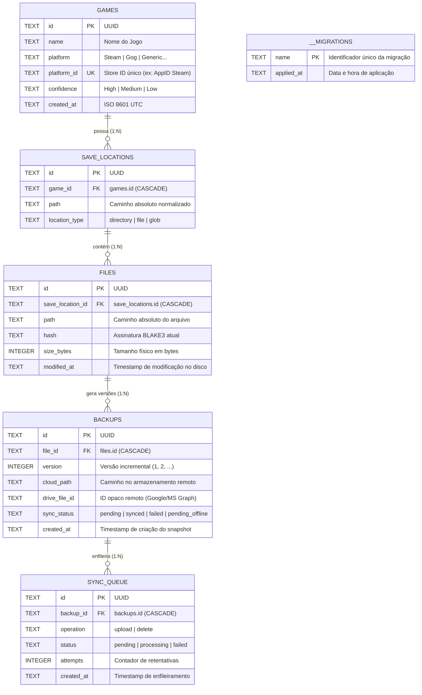

# 🗄️ Esquema do Banco de Dados — SaveVault

Este documento detalha o modelo relacional de persistência do **SaveVault**, implementado sobre **SQLite** com Write-Ahead Logging (`WAL`) e integridade referencial estrita (`PRAGMA foreign_keys = ON;`).

---

## 1. Diagrama Entidade-Relacionamento (ERD)



---

## 2. Tabelas do Sistema

### 2.1. `games`
Armazena os jogos identificados no sistema operacional.

| Coluna | Tipo | Restrições | Descrição |
| :--- | :--- | :--- | :--- |
| `id` | `TEXT` | `PRIMARY KEY` | UUID v4 gerado no cadastro. |
| `name` | `TEXT` | `NOT NULL` | Nome legível do título (ex: "Sekiro™: Shadows Die Twice"). |
| `platform` | `TEXT` | `NOT NULL` | Plataforma de origem (`Steam`, `Gog`, `Generic`, etc.). |
| `platform_id` | `TEXT` | `UNIQUE` | Identificador de loja único (AppID Steam, GOG Product ID). |
| `confidence` | `TEXT` | `NOT NULL DEFAULT 'medium'` | Grau de certeza da detecção (`high`, `medium`, `low`). |
| `created_at` | `TEXT` | `NOT NULL` | Data e hora de inclusão em formato ISO 8601 UTC. |

* **Índices de Unicidade:**
  * `idx_games_name_platform`: `UNIQUE INDEX (name COLLATE NOCASE, platform)` — Previne duplicação de jogos cadastrados com variações de caixa de texto.

---

### 2.2. `save_locations`
Mapeia os diretórios ou arquivos individuais onde o jogo armazena seus dados de progresso.

| Coluna | Tipo | Restrições | Descrição |
| :--- | :--- | :--- | :--- |
| `id` | `TEXT` | `PRIMARY KEY` | UUID v4 da localização. |
| `game_id` | `TEXT` | `NOT NULL REFERENCES games(id) ON DELETE CASCADE` | Vínculo com o jogo correspondente. |
| `path` | `TEXT` | `NOT NULL` | Caminho no disco (ex: `C:\Users\Nome\AppData\Roaming\Sekiro\76561198196716005\S0000.sl2`). |
| `location_type` | `TEXT` | `NOT NULL DEFAULT 'directory'` | Tipo do alvo: `'directory'`, `'file'` ou `'glob'`. |

* **Índices de Unicidade:**
  * `idx_save_locations_game_path`: `UNIQUE INDEX (game_id, path COLLATE NOCASE)` — Garante que o mesmo caminho não seja duplicado para o mesmo jogo.

---

### 2.3. `files`
Registra cada arquivo individual monitorado pelo sistema dentro de um `save_location`.

| Coluna | Tipo | Restrições | Descrição |
| :--- | :--- | :--- | :--- |
| `id` | `TEXT` | `PRIMARY KEY` | UUID v4 do arquivo monitorado. |
| `save_location_id` | `TEXT` | `NOT NULL REFERENCES save_locations(id) ON DELETE CASCADE` | Localização mãe. |
| `path` | `TEXT` | `NOT NULL` | Caminho canônico absoluto do arquivo no disco. |
| `hash` | `TEXT` | `NOT NULL` | Assinatura criptográfica BLAKE3 (64 caracteres hexadecimais). |
| `size_bytes` | `INTEGER` | `NOT NULL` | Tamanho exato em bytes. |
| `modified_at` | `TEXT` | `NOT NULL` | Timestamp da última modificação física observada. |

* **Índices:**
  * `idx_files_location`: `INDEX (save_location_id)` — Acelera a consulta de arquivos associados a um jogo.

---

### 2.4. `backups`
Histórico de versões de snapshots gerados pelo sistema.

| Coluna | Tipo | Restrições | Descrição |
| :--- | :--- | :--- | :--- |
| `id` | `TEXT` | `PRIMARY KEY` | UUID v4 do snapshot. |
| `file_id` | `TEXT` | `NOT NULL REFERENCES files(id) ON DELETE CASCADE` | Arquivo de origem do save. |
| `version` | `INTEGER` | `NOT NULL` | Número sequencial monótono da versão (1, 2, 3...). |
| `cloud_path` | `TEXT` | `NULL` | Caminho relativo do arquivo no armazenamento em nuvem. |
| `drive_file_id` | `TEXT` | `NULL` | Identificador opaco atribuído pela API remota (Google Drive / MS Graph). |
| `sync_status` | `TEXT` | `NOT NULL DEFAULT 'pending'` | Estado do sync: `'pending'`, `'synced'`, `'failed'`, `'pending_offline'`. |
| `created_at` | `TEXT` | `NOT NULL` | Data e hora exata da geração do snapshot (ISO 8601). |

* **Índices:**
  * `idx_backups_file`: `INDEX (file_id)` — Otimiza ordenações históricas por versão decrescente.

---

### 2.5. `sync_queue`
Fila transacional assíncrona consumida pelo worker de sincronização em nuvem.

| Coluna | Tipo | Restrições | Descrição |
| :--- | :--- | :--- | :--- |
| `id` | `TEXT` | `PRIMARY KEY` | UUID v4 da tarefa. |
| `backup_id` | `TEXT` | `NOT NULL REFERENCES backups(id) ON DELETE CASCADE` | Snapshot a ser transmitido ou removido. |
| `operation` | `TEXT` | `NOT NULL` | Operação a executar: `'upload'` ou `'delete'`. |
| `status` | `TEXT` | `NOT NULL DEFAULT 'pending'` | Estado da tarefa: `'pending'`, `'processing'`, `'failed'`. |
| `attempts` | `INTEGER` | `NOT NULL DEFAULT 0` | Quantidade de tentativas de envio já realizadas. |
| `created_at` | `TEXT` | `NOT NULL` | Momento em que a tarefa entrou na fila. |

* **Índices:**
  * `idx_sync_queue_status`: `INDEX (status)` — Permite leitura instantânea de tarefas pendentes.

---

### 2.6. `__migrations`
Controle de versão do esquema do banco de dados.

| Coluna | Tipo | Restrições | Descrição |
| :--- | :--- | :--- | :--- |
| `name` | `TEXT` | `PRIMARY KEY` | Identificador único da migração (ex: `001_initial_schema`). |
| `applied_at` | `TEXT` | `NOT NULL` | Data e hora de execução da migração. |

---

## 3. Histórico de Migrações

1. **`001_initial_schema`:** Criação das tabelas base (`games`, `save_locations`, `files`, `backups`, `sync_queue`) com restrições `FOREIGN KEY ... ON DELETE CASCADE`.
2. **`002_save_locations_unique_path`:** Poda registros duplicados de locais de save criados em sessões anteriores e cria o índice de unicidade `idx_save_locations_game_path`.
3. **`003_save_locations_nocase_index`:** Altera a unicidade do índice para `COLLATE NOCASE`, garantindo compatibilidade estrita com a semântica case-insensitive do Windows NTFS.
4. **`004_backups_drive_file_id`:** Adiciona a coluna `drive_file_id TEXT` na tabela `backups`, permitindo armazenar chaves remotas opacas do Google Drive e OneDrive.
5. **`005_games_unique_name_platform`:** Deduplica títulos de jogos com o mesmo nome e plataforma e cria o índice único `idx_games_name_platform`.

---

## 4. Consultas Úteis para Diagnóstico

### 1. Listar jogos com o timestamp do snapshot mais recente (Ordem da Tela Inicial):
```sql
SELECT g.name, sl.path, MAX(b.created_at) as last_backup
FROM save_locations sl
JOIN games g ON sl.game_id = g.id
LEFT JOIN files f ON f.save_location_id = sl.id
LEFT JOIN backups b ON b.file_id = f.id
GROUP BY sl.id
ORDER BY last_backup DESC;
```

### 2. Inspecionar histórico completo de snapshots de um jogo:
```sql
SELECT g.name, b.version, b.created_at, b.sync_status, f.path, f.size_bytes
FROM backups b
JOIN files f ON b.file_id = f.id
JOIN save_locations sl ON f.save_location_id = sl.id
JOIN games g ON sl.game_id = g.id
WHERE g.name LIKE '%Sekiro%'
ORDER BY b.created_at DESC;
```

### 3. Verificar itens pendentes na fila de sincronização:
```sql
SELECT sq.id, sq.operation, sq.attempts, sq.created_at, b.version, g.name
FROM sync_queue sq
JOIN backups b ON sq.backup_id = b.id
JOIN files f ON b.file_id = f.id
JOIN save_locations sl ON f.save_location_id = sl.id
JOIN games g ON sl.game_id = g.id
WHERE sq.status = 'pending';
```

