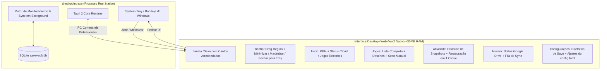

# Plano de Implementação: Desktop App "checkpoint" 🚀

> **Decisões Confirmadas pelo Usuário:**
> 1. **Nome do Produto:** **checkpoint**
> 2. **Plataforma:** **Aplicativo Desktop Nativo** (Windows), sem depender de navegador externo.
> 3. **Requisito Fundamental:** **Extremamente leve e clean**, reproduzindo fielmente a interface da imagem anexada e do arquivo `stitch_replica_o_de_interface.zip`.

---

## 🎯 Visão Geral da Arquitetura

Para atingir a máxima leveza (consumo de ~30MB de RAM e ~0% de CPU ocioso) sem carregar o peso de um Electron (que consome +200MB):
- Usaremos o **Tauri 2**, que utiliza o **Microsoft Edge WebView2 nativo do Windows** (já pré-instalado em todos os Windows 10 e 11).
- O frontend será em **HTML5 + Tailwind CSS + Vanilla JS** (código limpo extraído diretamente do `code.html` do zip).
- Não haverá dependências pesadas de Node.js/npm no runtime do executável final.



---

## 👥 Comportamento do Aplicativo Desktop

1. **Janela Moderna Clean (Frameless):**
   - A janela reproduz exatamente o visual do mockup: cantos arredondados, fundo sutil translúcido, sombra suave e barra de título integrada.
   - O topo da janela terá a propriedade `data-tauri-drag-region`, permitindo arrastar a janela livremente pela tela.
   - Os botões no canto superior direito executam ações nativas via Tauri API:
     - **Minimizar:** Minimiza para a barra de tarefas.
     - **Maximizar / Restaurar:** Alterna tamanho da janela.
     - **Fechar (X):** Não encerra o programa abruptamente — ele **oculta para a bandeja do sistema (System Tray)** perto do relógio, garantindo que o monitoramento continue protegendo os jogos em segundo plano!
2. **System Tray (Bandeja perto do Relógio):**
   - Ícone do **checkpoint** na barra de tarefas.
   - Clique duplo no ícone: abre/restaura a janela.
   - Menu de contexto (botão direito):
     - *Abrir checkpoint*
     - *Ocultar*
     - *Reconciliar Agora* (força scan)
     - *Sair do checkpoint* (finalização graciosa do processo).

---

## 🎨 Abas e Funcionalidades da Interface

### 1. Início (Dashboard Principal - Idêntico ao Mockup)
- **Status Header Banner:** Ícone de check esmeralda + *"Tudo certo. Seus saves estão protegidos e sincronizados."*
- **Badge Google Drive:** Botão com logotipo oficial do Google Drive e status *"Conectado"* (ou *"Desconectado"* se não configurado). Clicar nele leva diretamente à aba **Nuvem**.
- **KPIs (Cards de Métricas):**
  - Card 1: **X jogos protegidos** (total de jogos cadastrados).
  - Card 2: **Y saves sincronizados** (total de snapshots ativos).
  - Card 3: **Último backup** (horário do snapshot mais recente, ex: *"Hoje, 22:41"*).
- **Jogos Recentes:**
  - Lista com avatares estilizados/gradientes por jogo e plataforma (Steam, Dolphin, PCSX2, GOG, etc.).
  - Timestamp relativo e badge esmeralda *"Sincronizado"*.
  - Link *"Ver todos"* que alterna para a aba **Jogos**.

### 2. Jogos
- Lista detalhada de todos os jogos detectados no computador.
- Exibição das pastas de save associadas, tamanho e integridade.
- Botão *"Escanear Local"* para forçar detecção imediata.

### 3. Atividade
- Linha do tempo dos últimos backups realizados.
- Hash BLAKE3 de cada versão, tamanho e data.
- Botão **"Restaurar Save"** com diálogo de confirmação seguro.

### 4. Nuvem
- Status da integração com o Google Drive.
- Visualização da pasta remota na nuvem e fila de upload/retry.

### 5. Configurações
- Caminho do banco de dados SQLite (`%APPDATA%\SaveVault\savevault.db`).
- Pasta de destino dos backups (`config.paths.backup_dir`).
- Intervalo de debounce e reconciliação.

---

## 📦 Arquivos e Mudanças Propostas

### 1. Configuração do Workspace e Dependências
#### [MODIFY] `Cargo.toml` (Raiz)
Adicionar dependências do Tauri 2 no workspace:
```toml
tauri = { version = "2", features = ["tray-icon"] }
tauri-build = { version = "2", features = [] }
```

#### [MODIFY] `crates/savevault-app/Cargo.toml`
Habilitar `tauri` e `tauri-build`.

---

### 2. Configuração do Tauri
#### [NEW] `crates/savevault-app/tauri.conf.json`
Configurar identidade **checkpoint**:
- `productName`: `"checkpoint"`
- `identifier`: `"com.checkpoint.desktop"`
- `frontendDist`: `"./ui/frontend"`
- Janela principal: 1040x720, resizable, `decorations: false` (ou titlebar limpa), inicializada no centro da tela.

#### [NEW] `crates/savevault-app/build.rs`
Script de build padrão do Tauri 2 para Windows.

---

### 3. Frontend Nativo Clean
#### [NEW] `crates/savevault-app/ui/frontend/index.html`
Estrutura adaptada a partir de `code.html` do zip anexado:
- Tailwind CSS e fonte Inter.
- Container de janela desktop com header arrastável (`data-tauri-drag-region`).
- Todas as abas estruturadas (Início, Jogos, Atividade, Nuvem, Configurações).

#### [NEW] `crates/savevault-app/ui/frontend/app.js`
Lógica reativa limpa:
- Comunicação direta com o backend via `window.__TAURI__.core.invoke(...)`.
- Atualização em tempo real das métricas, jogos recentes e status da nuvem.
- Manipulação dos botões de minimizar, maximizar e fechar para a bandeja.

---

### 4. Backend Rust: Ponte de Comandos IPC
#### [NEW] `crates/savevault-app/src/ui/tauri_app.rs`
- Handlers Tauri (`#[tauri::command]`) para consulta de status, lista de jogos, restauração e reconciliação.
- Configuração do System Tray (ícone na barra do Windows, clique duplo para restaurar, menu de opções).
- Evento de interceptação `CloseRequested` (oculta na bandeja sem matar os backups).

#### [MODIFY] `crates/savevault-app/src/main.rs`
- Suporte para inicializar a GUI nativa por padrão (ou via flags/CLI quando invocado pelo terminal).

---

## 🧪 Plano de Verificação

### 1. Verificação Automatizada
- Rodar `cargo check -p savevault-app` para validar sintaxe e tipos.
- Executar a suíte de testes `cargo test --workspace` para garantir que nenhuma lógica do motor de backup foi afetada.

### 2. Validação Manual
- Executar `cargo run -p savevault-app`.
- Verificar se a janela nativa do **checkpoint** abre com o visual exato do mockup anexado.
- Testar arrastar a janela pelo topo e os botões de minimizar e maximizar.
- Clicar no botão Fechar (X) e comprovar que o ícone permanece na bandeja perto do relógio e que o processo continua vigiando saves.
- Clicar no ícone da bandeja para reabrir a janela instantaneamente.
- Navegar pelas abas e verificar a listagem real dos jogos instalados no PC.
