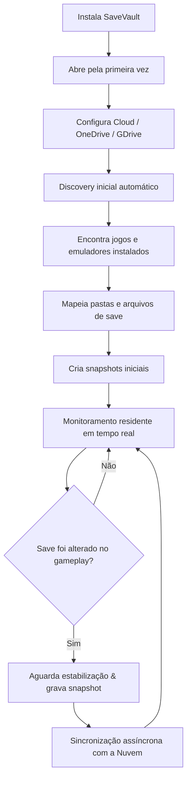

# 📋 Especificação Funcional e Requisitos — SaveVault

> Documento canônico de especificação de produto e regras de negócio do **SaveVault**.

**Stack:** 100% Rust  
**Plataforma Inicial:** Windows 10/11 x64  
**Versão:** v0.9.0-rc (Release Candidate)  

---

## 1. Proposta de Valor e Posicionamento

O SaveVault roda silenciosamente em segundo plano no computador com uma única finalidade: **encontrar e proteger automaticamente os saves dos jogos do usuário**, versionando-os localmente e sincronizando-os com a nuvem sem exigir intervenção manual.

> *"Você joga. O SaveVault encontra e protege seus saves automaticamente."*

---

## 2. Escopo do Produto

### 2.1. Plataformas e Ambientes
* **Sistema Operacional:** Windows 10/11 x64.
* **Operação:** Modo residente contínuo na bandeja do sistema (*System Tray*).
* **Consumo Alvo:** 15MB a 25MB de RAM e 0% de CPU quando ocioso.

### 2.2. Fontes de Detecção
* **Steam:** Leitura de bibliotecas `libraryfolders.vdf` e manifestos `.acf`.
* **GOG Galaxy:** Leitura do Registro do Windows (32 e 64-bit) e estruturas de diretórios.
* **Emuladores:** Dolphin, PCSX2, PPSSPP e RetroArch.
* **Heurística Genérica:** Varredura em pastas padrão (`%APPDATA%`, `%LOCALAPPDATA%`, `Saved Games`, `Documents`).
* **Catálogo Comunitário:** Ludusavi Manifest (+53.000 títulos).
* **Inclusão Manual:** Cadastro via interface ou CLI de pastas e arquivos arbitrários.

### 2.3. Provedores de Nuvem Suportados
* **Pastas Locais de Nuvem:** Microsoft OneDrive, Google Drive Desktop, Dropbox, iCloud Drive (sem necessidade de chaves de API).
* **Google Drive:** Integração REST v3 via OAuth 2.0 PKCE e Windows Credential Manager.
* **Microsoft OneDrive:** Integração Graph API via OAuth 2.0 PKCE.

### 2.4. O que é Protegido
* **Estritamente dados de progresso e saves do usuário** (`.sav`, `.sl2`, `.dat`, `.bin`, `.vdf`, etc.).
* **Não inclui:** binários executáveis de jogos, mods, pacotes de textura, vídeos, screenshots, shaders ou caches transitórios.

---

## 3. Regras de Negócio e Invariantes Críticos

1. **Nunca realizar upload ou backup prematuro:**  
   O processo de gravação de um jogo pode levar centenas de milissegundos ou envolver escrita em arquivos temporários. O sistema **obrigatoriamente aguarda a estabilização do arquivo** (`StabilityChecker`) e o fechamento do handle de escrita antes de ler o save.

2. **Deduplicação por Hash Criptográfico (BLAKE3):**  
   Mesmo que o arquivo de save sofra evento de modificação no disco (timestamp atualizado), um novo snapshot só é registrado se o hash **BLAKE3 for diferente** do último snapshot armazenado.

3. **Segurança Absoluta na Restauração (Safety Backups):**  
   Antes de restaurar um snapshot histórico sobre o save ativo do jogo, o sistema gera compulsoriamente uma cópia de segurança (`.savevault_safety_<uuid>_<n>`) no diretório do jogo. Se o usuário restaurar o save errado por engano, o save anterior nunca é perdido.

4. **Escrita Atômica via Staging:**  
   A gravação de arquivos de save restaurados ou backups físicos ocorre inicialmente em arquivos temporários (`.restore_tmp_<uuid>`) no mesmo volume de disco, sendo promovida para o caminho definitivo através de `MoveFileExW` com `MOVEFILE_REPLACE_EXISTING`.

5. **Preferir Falsos Negativos a Falsos Positivos no Generic Detector:**  
   Perder um save não detectado automaticamente é contornável pelo usuário (que pode adicionar a pasta em 1 clique). Capturar arquivos errados (ex: arquivos de configuração geral do sistema ou arquivos de log) polui o banco e consome espaço indevido de backup.

6. **Operação Desconectada (Offline-First):**  
   A ausência de conexão com a internet não interrompe o monitoramento ou a geração de snapshots locais. As tarefas pendentes de upload são acumuladas na tabela `sync_queue` e processadas assim que a conectividade for restabelecida.

---

## 4. Licenciamento e Dados de Terceiros

O SaveVault consome dados do **Ludusavi Manifest** (mantido sob licença CC BY-NC-SA 3.0, originado da PCGamingWiki).
* Todo o código Rust de parsing e resolução de variáveis foi desenvolvido **100% do zero** dentro do SaveVault (sem reutilização de código do projeto Ludusavi).
* Para distribuição gratuita e open-source, o consumo dos dados é perfeitamente compatível. Em caso de planos comerciais futuros, é recomendável manter uma base proprietária ou licenciar formalmente as fontes de dados.
