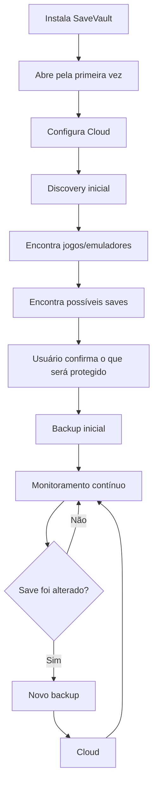
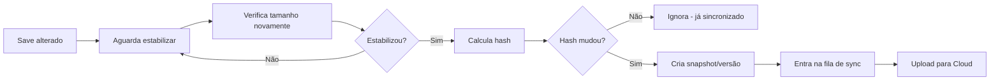

# SaveVault — Especificação do MVP

> Documento de referência para desenvolvimento. Pensado para ser lido por agentes de IA (Claude Code, etc.) como contexto de projeto — mantenha atualizado conforme decisões mudarem.

**Stack:** 100% Rust
**Plataforma inicial:** Windows 10/11 x64
**Status:** Pré-desenvolvimento — definindo arquitetura

---

## ⚠️ Pendência legal (resolver antes de embutir dados no produto)

O plano é usar o **[Ludusavi Manifest](https://github.com/mtkennerly/ludusavi-manifest)** como base de conhecimento de onde ficam os saves de cada jogo. Esse manifesto é compilado a partir do conteúdo da **PCGamingWiki**, cujo conteúdo é licenciado como **CC BY-NC-SA 3.0** (não-comercial, compartilhamento pelo mesmo tipo de licença, com atribuição).

- Se o SaveVault permanecer um projeto pessoal/open-source e não-comercial, não há problema.
- Se o SaveVault virar produto pago (ex.: assinatura de cloud), essa cláusula **não-comercial** pode ser incompatível com embutir o manifesto diretamente no produto.
- Ação recomendada: validar isso com um advogado ou buscar alternativas (base própria construída a partir de fontes com licença permissiva, ou acordo/licenciamento com a PCGamingWiki/Ludusavi) antes do lançamento comercial.
- Isso **não bloqueia o desenvolvimento do MVP** — só precisa estar resolvido antes de monetizar.

---

## 1. Proposta

O SaveVault roda em segundo plano no computador com uma única finalidade: **encontrar e proteger automaticamente os saves dos jogos do usuário**, sincronizando-os com a cloud sem que o usuário precise gerenciar isso manualmente.

Frase de posicionamento:

> "Você joga. O SaveVault encontra e protege seus saves automaticamente."

Fluxo principal:



---

## 2. Escopo do MVP

### Sistemas suportados
- Windows 10/11, x64
- Funcionamento em background (system tray)
- Linux e macOS: pós-MVP

### Fontes de detecção
- Steam
- GOG
- Dolphin
- PCSX2
- PPSSPP
- RetroArch
- Jogos independentes / PC genéricos
- Jogos não identificados automaticamente (fluxo manual)

### Cloud
- MVP: Google Drive (OAuth 2.0, sem armazenar senha — apenas tokens)
- Pós-MVP: OneDrive, Dropbox, S3, WebDAV

### O que é protegido
Somente **arquivos relacionados a saves**. Não incluir:
jogos, executáveis, mods, screenshots, vídeos, cache, shaders, instaladores, ou qualquer arquivo grande que não seja save.

### O que o MVP **não** fará
- Backup de jogos completos
- Sincronização de mods, configs completas ou screenshots
- Multiplayer / compartilhamento de saves / marketplace
- Servidor próprio
- IA genérica para descobrir qualquer jogo
- Suporte a todas as plataformas
- Sincronização em tempo real entre dois PCs simultaneamente
- Aplicativo mobile

Foco: **descobrir → proteger → versionar → sincronizar → restaurar saves.**

---

## 3. Arquitetura técnica

| Componente | Escolha | Observação |
|---|---|---|
| Linguagem | **Rust** | Todo o projeto, sem Go |
| Desktop UI | **Tauri** (Rust + frontend web) ou **iced/egui** (100% nativo) | Definir com base na complexidade de UI desejada |
| Filesystem watcher | crate `notify` | Monitoramento eficiente sem varrer o HD inteiro |
| Hashing | crate `blake3` (preferencial) ou `sha2` | Para detectar mudanças reais nos saves |
| Banco local | SQLite via `rusqlite` ou `sqlx` | Estado local: jogos, saves, versões, fila |
| Parsing do manifest | `serde` + `serde_yaml` | Ludusavi Manifest (YAML) |
| Cloud (Google Drive) | `oauth2` + `google-drive3` ou REST via `reqwest` | OAuth 2.0, sem senha armazenada |
| Configuração | `serde` + `toml` | Config local do usuário |
| Async runtime | `tokio` | Concorrência para watcher, fila de sync, uploads |
| Empacotamento | Instalador Windows (via Tauri bundler ou `cargo-wix`) | — |

### Módulos

```
SaveVault
├── core/
│   ├── game_registry
│   ├── save_registry
│   ├── snapshot_manager
│   └── config
├── discovery/
│   ├── filesystem_scanner
│   ├── launcher_detection      (Steam, GOG, ...)
│   └── emulator_detection      (Dolphin, PCSX2, PPSSPP, RetroArch)
├── detectors/
│   ├── manifest_detector       (consulta o Ludusavi Manifest)
│   ├── steam
│   ├── gog
│   ├── dolphin / pcsx2 / ppsspp / retroarch
│   └── generic                 (heurística p/ jogos desconhecidos)
├── monitor/
│   └── file_watcher            (notify + debounce de estabilização)
├── backup_engine/
│   ├── hashing
│   ├── snapshot
│   └── versioning
├── sync_engine/
│   ├── queue
│   ├── retry
│   └── conflict_handling
├── cloud/
│   └── google_drive
├── database/
│   └── sqlite
└── ui/
    ├── dashboard
    ├── games
    ├── activity
    └── settings
```

---

## 4. Integração com o Ludusavi Manifest

O manifesto é um YAML público mantido pela comunidade, com dados de mais de 19.000 jogos, indicando onde ficam os saves de cada um.

Exemplo de entrada:

```yaml
Stardew Valley:
  files:
    <winAppData>/StardewValley/Saves:
      tags: [save]
  installDir:
    "Stardew Valley": {}
  steam:
    id: 413150
```

### Placeholders a resolver
| Placeholder | Significado |
|---|---|
| `<root>` | Diretório raiz configurado (ex.: pasta de instalação da Steam) |
| `<base>` | Diretório base do jogo |
| `<home>` | Pasta do usuário |
| `<winAppData>` | `%APPDATA%` |
| `<winLocalAppData>` | `%LOCALAPPDATA%` |
| `<winDocuments>` | Pasta Documentos do usuário |
| `<xdgData>` / `<xdgConfig>` | Equivalentes Linux (pós-MVP) |

### Como o Manifest Detector usa isso
1. Identifica o jogo via Steam AppID (ou nome da pasta de instalação para GOG/genéricos).
2. Procura a entrada correspondente no manifest.
3. Resolve os placeholders para caminhos reais do sistema.
4. Aplica as regras `when` (SO, loja) para filtrar o que se aplica.
5. Marca o resultado com **Confidence: Alta** (fonte conhecida e validada pela comunidade).

Quando o jogo **não** está no manifest, cai para o **Generic Detector** (heurístico, ver seção 6).

---

## 5. Modelo de dados (SQLite)

```
Games
- id, nome, plataforma, launcher/origem, identificação (steam_appid etc.), confidence

SaveLocations
- id, game_id, caminho, tipo (file/registry)

Files
- id, save_location_id, caminho, hash, tamanho, data_modificacao

Backups
- id, file_id, versao, cloud_path, data

SyncQueue
- id, arquivo, operacao, status, tentativas
```

---

## 6. Sistema de confiança (Confidence Score)

Não exibido como nota numérica ao usuário — apenas internamente: **Alta / Média / Baixa**.

| Evidência | Resultado |
|---|---|
| Steam AppID + caminho conhecido pelo manifest | Alta |
| Pasta de emulador + estrutura conhecida | Alta |
| Arquivo `save.dat`-like em local desconhecido mas com nome do jogo na pasta | Média |
| Arquivo aleatório em `Documents` sem correlação clara | Baixa |

Detecções de **Baixa** confiança sempre exigem confirmação manual do usuário — nunca entram em backup automático.

### Generic Detector (heurística para jogos fora do manifest)
Combina evidências, não assume "qualquer .dat é save":
- localização conhecida / nome da pasta / nome e extensão do arquivo
- estrutura de diretórios
- tamanho do arquivo
- pasta contém nome do jogo
- processo do jogo em execução (evolução pós-MVP, ver seção 8)

---

## 7. Fluxos principais

### 7.1 Monitoramento e backup automático


Ponto crítico: **nunca fazer upload imediato ao detectar mudança** — o jogo pode estar no meio de uma gravação. Sempre aguardar estabilização do arquivo.

### 7.2 Versionamento
- Manter as últimas **N versões** por save (padrão: 10, configurável).
- Nunca sobrescrever a versão anterior diretamente — sempre criar uma nova versão.

### 7.3 Modo offline
- Se não houver internet: marcar como "Backup local pendente" e continuar monitorando normalmente.
- Ao detectar conexão: processar a fila de sync pendente.

### 7.4 Restauração (segurança)
Nunca sobrescrever o save atual diretamente:
```
Save atual → backup temporário → restauração
```
Isso permite desfazer caso o usuário restaure a versão errada.

---

## 8. Evoluções pós-MVP (não bloqueiam o v1.0)
- Detecção de processo em execução (`Game.exe` ativo) para melhorar confiança da identificação
- Linux e macOS
- OneDrive, Dropbox, S3, WebDAV
- Retenção configurável de versões
- App mobile / sincronização em tempo real entre dois PCs

---

## 9. Roadmap

| Versão | Entregas |
|---|---|
| **v0.1 — Core** | Setup Rust, SQLite, config, scanner básico, registro de saves, logs (sem cloud) |
| **v0.2 — Google Drive** | OAuth, upload, download, sync queue, retry, modo offline |
| **v0.3 — Automação** | File watcher (`notify`), backup automático, hashing, versionamento, execução em background |
| **v0.4 — Detectors** | Steam, GOG, Dolphin, PCSX2, PPSSPP, RetroArch, integração com Ludusavi Manifest, Generic Detector |
| **v0.5 — Restore** | Restaurar jogo, restaurar versão específica, backup de segurança antes de restaurar, restore seletivo |
| **v1.0** | UI polida, instalador, ícone de bandeja, recovery, cloud estável, detecção confiável, documentação |

---

## 10. Notas para agentes de IA / desenvolvimento

- Projeto 100% Rust — não sugerir dependências de outras linguagens.
- Priorizar crates bem mantidas do ecossistema Rust (`tokio`, `notify`, `serde`, `rusqlite`/`sqlx`, `blake3`).
- O parser do Ludusavi Manifest deve ser implementado **do zero** neste projeto (não reutilizar/vender código do ludusavi) — apenas os **dados** (YAML) são consumidos, sujeitos à pendência legal da seção 0.
- Qualquer módulo que grave ou sobrescreva arquivos de save do usuário deve seguir o princípio de segurança da seção 7.4 (backup antes de sobrescrever).
- Ao implementar o Generic Detector, preferir falsos negativos (não detectar) a falsos positivos (detectar arquivo errado como save) — perder um save não detectado é recuperável pelo usuário; corromper a estrutura de backup com lixo não é.
